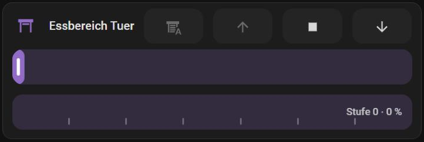

# Beschattung Steuerung (Automatik + Auf/Stopp/Ab)

Beschattung Steuerung: Automatik-Taste + Auf / Stopp / Ab in einer Zeile



*Oben in der Kachel: Automatik-Taste und Auf / Stopp / Ab (hier in der Beschattung-Karte).*

## Installation

### Über den Marketplace (Home Assistant 2026.11 und neuer)

1. **Einstellungen** → **Marketplace** → **Aus Link hinzufügen**.
2. Die Adresse dieses Repositorys eintragen, Kategorie **Dashboard**.
3. **Beschattung Steuerung (Automatik + Auf/Stopp/Ab)** installieren. Die Ressource wird dabei automatisch eingetragen.

### Über HACS (ältere Versionen)

**HACS** → ⋮ → **Benutzerdefinierte Repositories** → Adresse dieses Repositorys, Typ **Dashboard** → installieren.

### Manuell

`beschattung-steuerung.js` nach `/config/www/` kopieren und unter **Einstellungen** → **Dashboards** → ⋮ → **Ressourcen**
als JavaScript-Modul `/local/beschattung-steuerung.js` eintragen.

## Verwendung

```yaml
type: tile
entity: cover.beispiel
features:
  - type: custom:beschattung-steuerung
```

## Konfiguration

```
Beschattung Steuerung: Automatik-Taste + Auf / Stopp / Ab in einer Zeile
(eine Tile-Karte zeigt inline nur ein Feature, deshalb alles in einem Element).

  features_position: inline
  features:
    - type: custom:beschattung-steuerung
      automatik: switch.essbereichtuer   # optional, ohne Eintrag keine Automatik-Taste
```

## Lizenz

MIT
